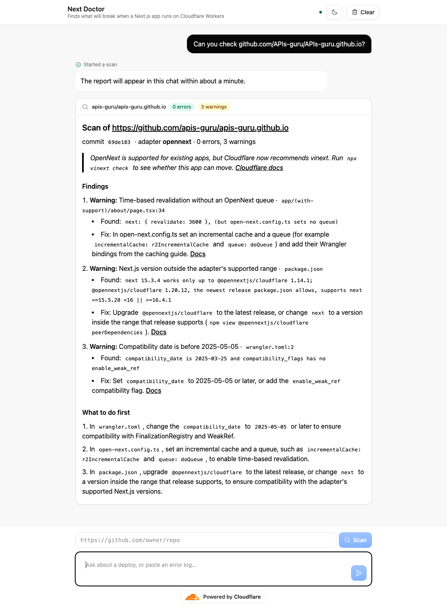

# cf_ai_next_doctor

A deploy doctor for Next.js apps on Cloudflare Workers.

Give it a public GitHub repository, and it tells you what will break when the app runs on
Workers: which Cloudflare path the app is on (vinext, OpenNext, or the deprecated
next-on-pages), every failing check with file and line, the exact fix, and the Cloudflare
doc page and GitHub issues behind each one. Paste a build or deploy error, and it matches it
against the same knowledge base. Llama 3.3 explains and orders the fixes; it cannot add or
remove a finding.

Built for Cloudflare's AI application assignment. The AI prompts used to build it are in
[PROMPTS.md](PROMPTS.md), and the design decisions in [docs/DECISIONS.md](docs/DECISIONS.md).



_A real run: Llama 3.3 on Workers AI called `scan_repo`, the Workflow scanned the repository,
and the report arrived about 10 seconds later._

## Run it locally

You need Node.js 22.13 or later. Workers AI runs on Cloudflare even during local development,
so the full app needs a (free) Cloudflare account.

```sh
npm install
npx wrangler login     # Workers AI calls use your account's free allowance
npm run dev            # open http://localhost:5173
```

Then try:

1. **Scan a repository.** Paste `https://github.com/APIs-guru/APIs-guru.github.io` into the
   repository box and press **Scan**, or ask in the chat: _"Can you check
   github.com/APIs-guru/APIs-guru.github.io?"_ A status line shows the scan's progress, and
   the report appears in the chat within about a minute.
2. **Paste an error.** For example: _"My deploy fails with `Error: No such module
"node:buffer".`"_ The agent matches it to "Node.js compatibility is not enabled" and gives
   the fix and its sources.
3. **Ask about earlier scans.** _"What did my earlier scans find?"_ The agent reads this
   chat's scan history from its Durable Object.

### Run without a Cloudflare account

```sh
CLOUDFLARE_VITE_FORCE_LOCAL=true npm run dev
```

Everything except the model runs on your machine: the Durable Object, the Workflow, the
GitHub download and every check. The **Scan** button works and posts full reports. Chat replies
need Workers AI, so they show an error, and reports say the explanation is unavailable.

### Tests and checks

```sh
npm test            # unit tests: no network and no Cloudflare account (mock model, fake fetch, node:sqlite)
npm run check       # format, lint, typecheck and tests
```

### Deploy to your own account

```sh
npm run deploy
```

Use the Workers Paid plan. A scan step parses the repository archive, which took 17–330 ms of
CPU per repository when measured in Node, and Workflows on the free plan allow 10 ms of CPU
per step.

## How it maps to the assignment

| Requirement             | Where                                                                                                                                                                                                                                            |
| ----------------------- | ------------------------------------------------------------------------------------------------------------------------------------------------------------------------------------------------------------------------------------------------ |
| LLM                     | Llama 3.3 70B (`@cf/meta/llama-3.3-70b-instruct-fp8-fast`) on Workers AI. It runs the chat with tool calls ([src/server.ts](src/server.ts)) and writes each report's explanation ([src/scan/explain-findings.ts](src/scan/explain-findings.ts)). |
| Workflow / coordination | `ScanWorkflow` on Cloudflare Workflows: scan, explain, post, each step retried on its own ([src/scan/scan-workflow.ts](src/scan/scan-workflow.ts)). The agent starts it and receives progress and results over RPC.                              |
| User input via chat     | React chat UI on the Agents SDK (`useAgent`, `useAgentChat`), plus a repository box that starts scans directly ([src/app.tsx](src/app.tsx), [src/ui/](src/ui)).                                                                                  |
| Memory or state         | One Durable Object per browser. It keeps the chat messages and a `scans` table in SQLite ([src/scan/scan-history.ts](src/scan/scan-history.ts)), and live scan progress in agent state that every open tab sees.                                 |

## How a scan works

```
Scan button ─┐
             ├─▶ ChatAgent.startScan (Durable Object) ──▶ ScanWorkflow
chat ─ Llama ┘        ▲  progress, report                  1. scan repository
   scan_repo tool     │                                       one codeload tarball → streaming tar reader
                      │                                       → snapshot of config + server code
                      │                                       → 12 static checks (+ npm peer ranges)
                      │                                    2. explain findings (Llama 3.3; repo text fenced as untrusted)
                      └─────── saveScan (RPC) ◀──────────  3. post report
   SQLite: messages + scans table · state: active scans → every open tab
```

- **The findings come from code, not the model.** The report lists every finding from the
  checks, then Llama's explanation. If Workers AI is down, the report is posted without it.
- **Repository text is untrusted.** Paths and evidence lines go into the prompt inside one
  `<untrusted>` fence, with tokens, keys and emails redacted ([src/guardrails.ts](src/guardrails.ts)).
- **One download per scan.** The repository arrives as a single codeload tarball, read as a
  stream, and only the files the checks need are kept: one subrequest, and no GitHub token.

## What it checks

Each entry cites an official doc page and at least one public GitHub issue
([src/knowledge/failures.ts](src/knowledge/failures.ts)); an entry without an issue does not
compile.

| Failure                                                    | Repo scan | Error log | Evidence                                                                                                                                                                                                                                                    |
| ---------------------------------------------------------- | --------- | --------- | ----------------------------------------------------------------------------------------------------------------------------------------------------------------------------------------------------------------------------------------------------------- |
| Route sets `export const runtime = "edge"`                 | yes       | no        | [#525](https://github.com/opennextjs/opennextjs-cloudflare/issues/525), [#1338](https://github.com/cloudflare/vinext/issues/1338)                                                                                                                           |
| `proxy.ts` needs @opennextjs/cloudflare 1.20.3 or later    | yes       | yes       | [#1213](https://github.com/opennextjs/opennextjs-cloudflare/issues/1213), [#1277](https://github.com/opennextjs/opennextjs-cloudflare/issues/1277)                                                                                                          |
| Node.js compatibility is not enabled                       | yes       | yes       | [#199](https://github.com/cloudflare/next-on-pages/issues/199)                                                                                                                                                                                              |
| Compatibility date is before 2025-05-05                    | yes       | yes       | [#660](https://github.com/opennextjs/opennextjs-cloudflare/issues/660)                                                                                                                                                                                      |
| Client or I/O created at module scope                      | yes       | yes       | [#548](https://github.com/opennextjs/opennextjs-cloudflare/issues/548), [#949](https://github.com/cloudflare/next-on-pages/issues/949), [#537](https://github.com/cloudflare/vinext/issues/537), [#2490](https://github.com/cloudflare/workerd/issues/2490) |
| `getCloudflareContext()` called at module scope            | yes       | no        | [#231](https://github.com/opennextjs/opennextjs-cloudflare/issues/231), [#596](https://github.com/opennextjs/opennextjs-cloudflare/issues/596)                                                                                                              |
| next.config does not call `initOpenNextCloudflareForDev()` | yes       | yes       | [#317](https://github.com/opennextjs/opennextjs-cloudflare/issues/317)                                                                                                                                                                                      |
| Package with workerd-specific code is bundled              | yes       | yes       | [#548](https://github.com/opennextjs/opennextjs-cloudflare/issues/548)                                                                                                                                                                                      |
| Dependency uses a native Node.js addon                     | yes       | yes       | [#1394](https://github.com/opennextjs/opennextjs-cloudflare/issues/1394), [#4587](https://github.com/cloudflare/workerd/issues/4587)                                                                                                                        |
| Time-based revalidation without an OpenNext queue          | yes       | yes       | [#466](https://github.com/opennextjs/opennextjs-cloudflare/issues/466)                                                                                                                                                                                      |
| OpenNext cache override without its Wrangler binding       | yes       | yes       | [#1108](https://github.com/opennextjs/opennextjs-cloudflare/issues/1108), [#502](https://github.com/opennextjs/opennextjs-cloudflare/issues/502)                                                                                                            |
| Next.js version outside the adapter's supported range      | yes       | yes       | [#1049](https://github.com/opennextjs/opennextjs-cloudflare/issues/1049), [#1157](https://github.com/opennextjs/opennextjs-cloudflare/issues/1157)                                                                                                          |
| Node.js API that Workers only stub                         | no        | yes       | [#623](https://github.com/opennextjs/opennextjs-cloudflare/issues/623), [#79](https://github.com/opennextjs/opennextjs-cloudflare/issues/79)                                                                                                                |
| Worker startup exceeds the CPU limit                       | no        | yes       | [#10723](https://github.com/cloudflare/workers-sdk/issues/10723), [#54](https://github.com/cloudflare/next-on-pages/issues/54)                                                                                                                              |

The checks were tried on 14 public OpenNext repositories before release. That run found and
fixed false alarms such as commented-out config and HTTP-based Redis clients.

## Why this problem

Deploying Next.js to Workers has a small set of recurring failures. Searching GitHub on
2026-10-15 across `opennextjs/opennextjs-cloudflare`, `cloudflare/vinext` and the archived
`cloudflare/next-on-pages` found 18 recurring failure types, 14 of them detectable from
repository files alone. Examples: a Next.js version ahead of the adapter's support range (~40
issues), `Could not resolve "<package>"` at bundle time (66), ISR used without a cache
backend (45), `export const runtime = "edge"` left in from old tutorials (87), and `proxy.ts`
with OpenNext (25). Three widely copied checks are now stale (for example the 3 MiB / 10 MiB
size limit, removed on 2026-09-04) and are deliberately not checked.

## Limits, and what I would do with more time

- **Static analysis only.** Build-time and runtime failures are recognised from pasted logs,
  not predicted. Next step: run `next build` and the adapter in a Cloudflare Sandbox.
- **Exact log matching.** Reworded errors can miss. Next step: match logs semantically with
  Vectorize, behind a KV flag that falls back to rules only.
- **Public repositories only**, through codeload. Private ones would need a GitHub App.
- **Declared version ranges, not the lockfile.** The version check reasons over every
  release `package.json` allows instead of reading four lockfile formats.
- **Pasted logs reach the model as typed.** Only quoted lines are redacted.
- **Chat replies arrive whole, not word by word.** workers-ai-provider 3.3.1 reads every
  streamed tool-call fragment from Workers AI twice, which corrupts tool arguments, so the
  chat asks for whole responses ([src/workers-ai.ts](src/workers-ai.ts)). With a fixed
  provider, streaming can come back.

## Credits

Started from [cloudflare/agents-starter](https://github.com/cloudflare/agents-starter) (MIT).
